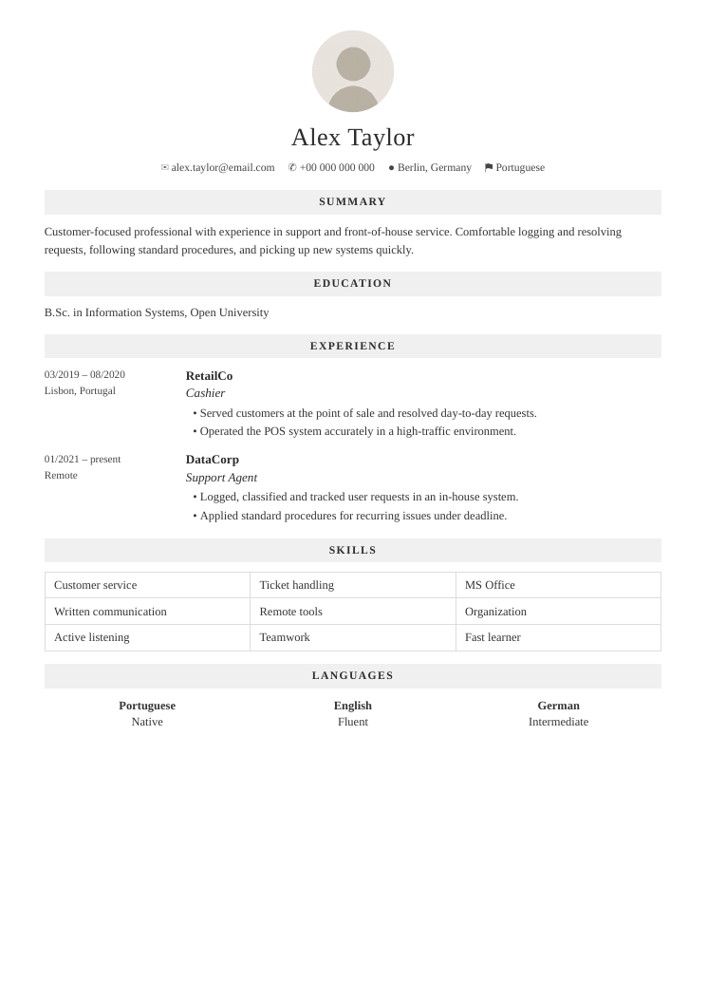

# Perfect CV

Tailor **your own** CV to a specific job, keeping your layout and your voice. Perfect CV
reads the CV you already have and adjusts the content to match the role you're applying
for. Same design, same you, just a sharper fit.



## The idea

Most CV tools hand you their template and make you start over. Perfect CV does the
opposite: you upload the CV you already have, and it keeps your layout. For each job, it
reframes your summary, surfaces the skills and experience the ad actually asks for, and
mirrors the role's language, without ever inventing anything.

Two hard rules:

- **No lies.** It never adds experience, tools, certificates or dates you don't have.
  Tailoring is emphasis and wording, not fiction. If a job needs something you lack, it
  tells you instead of faking it.
- **No robotic writing.** Plain, human sentences in your own register. No AI tells, no
  filler.

## How it works

It's a [Claude](https://claude.ai) skill. In your first message you upload your current
CV (PDF or Word). Claude rebuilds it as clean HTML that mirrors your design, shows it
back to confirm the look, then tailors that layout to each job ad you paste. Output is a
one-page PDF, with a matching cover letter on request. Everything runs locally via
[WeasyPrint](https://weasyprint.org/); nothing leaves your machine.

## Install (as a Claude skill)

Put this folder in your Claude skills directory (or your project). Claude loads
`SKILL.md` on its own. Then just say:

## How to use

1. **Add the Perfect CV skill** to Claude.
2. **Upload your current CV** so Claude learns your layout.
3. **Paste the full job ad** — and that's it. You get a tailored, one-page CV back.

Want a cover letter too? Just ask.

## Standalone

```bash
pip install weasyprint pdfplumber pdf2image
python scripts/render.py build cv.html My_CV.pdf   # HTML -> one-page PDF + preview
```

## Customize

`templates/` holds a neutral fallback design for people who have no CV yet. If you do
have one, your file is the template, so you rarely touch these.

## Contributing

PRs welcome: better layout capture, more languages, an ATS-plain variant. Open an issue
with a CV or job ad that tripped it up.

## License

MIT — see [LICENSE](LICENSE).
